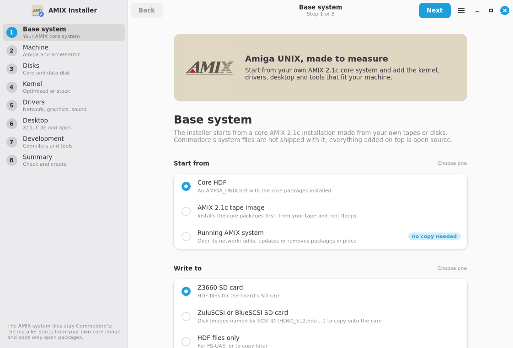
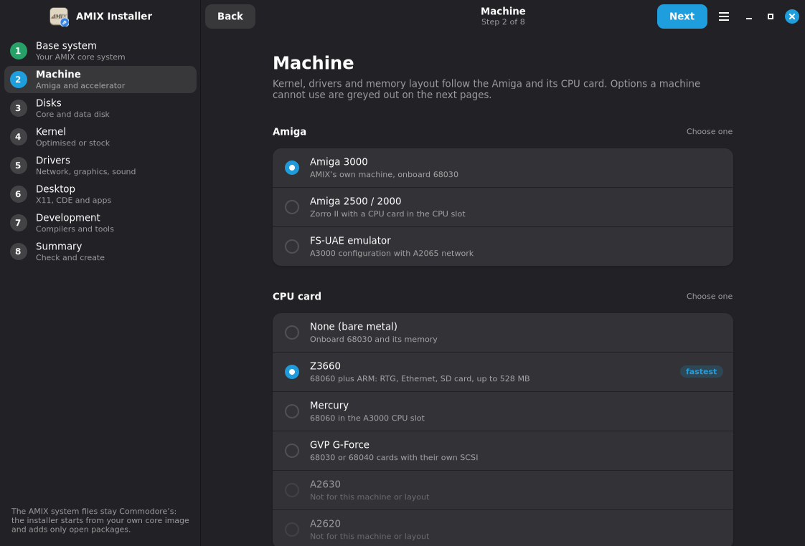
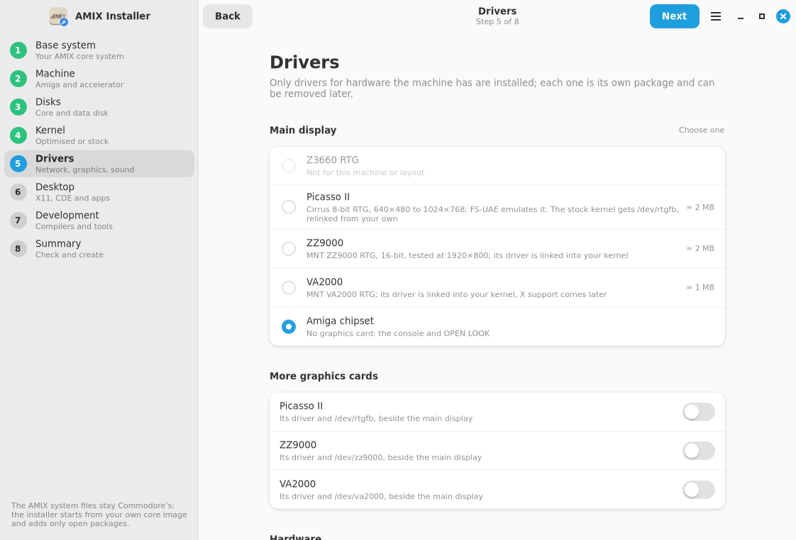
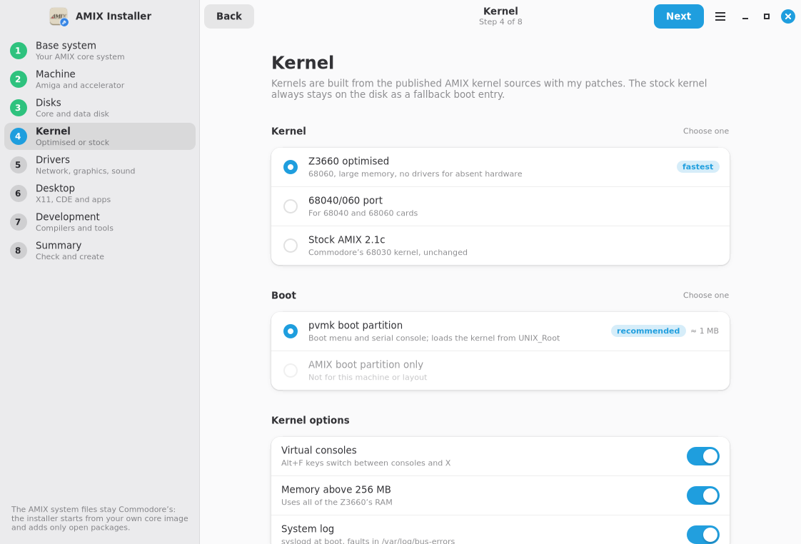
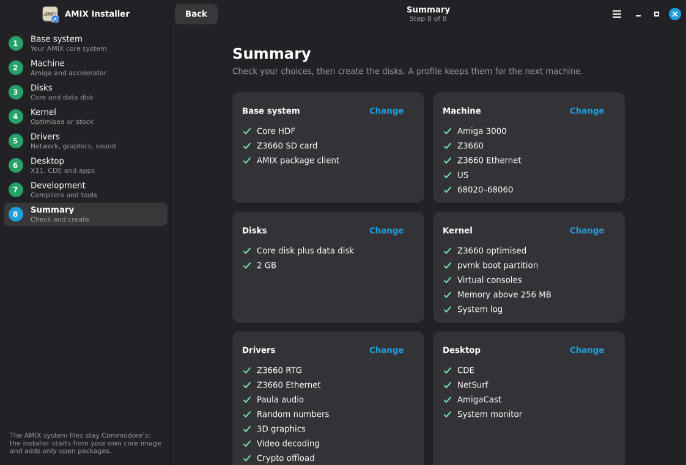

<p align="center"></p>

# linux-amix

Amiga UNIX (AMIX) tools for Linux, as Debian packages: the **AMIX
Installer**, the AMIX **cross compilers** and **sysroot**, the **pvmk** boot
loader and the **kernel driver kits** for graphics and network cards.

They are built from the same pinned sources as the OpenIndiana packages
(publisher `amix`), so a disk or a program made on Linux is the same as one
made on OpenIndiana or Solaris. Each package here is a recipe in
`components/`: a pinned upstream archive with its sha256, patches, and the
build steps.

## The AMIX Installer

A GNOME app that makes an AMIX disk for one machine from **your own** AMIX
2.1c core system (a core HDF, a tape image with its root floppy, or a
running AMIX). It never ships Commodore's files: it adds the open kernel,
drivers, desktop and tools that fit the machine.

- Machines: Amiga 3000, Amiga 2500, Amiga 4000 (with a 68040 or 68060
  card), FS-UAE; CPU cards up to the 68060 (Z3660, Mercury, A3640, A2630).
- Graphics: Z3660 RTG, Picasso II, MNT ZZ9000, MNT VA2000, or the chipset.
- Network: A2065, Z3660 Ethernet, Hydra Systems AmigaNet, Individual
  Computers X-Surf 100, the ZZ9000's Ethernet port.
- Several cards in one machine: a main display (console and X) and the card
  the install runs over, plus any further graphics and network cards.
- The drivers for the cards you choose are linked into **your own** stock
  kernel on this computer, before anything is written; the stock kernel
  stays on the disk as a fallback.
- Writes HDF files, a pvmk boot disk and an FS-UAE configuration, or straight
  onto the SD card of a ZuluSCSI, BlueSCSI or Z3660: it reads the card's
  configuration (`zuluscsi.ini`, `bluescsi.ini`, `z3660cfg.txt`), stops if an
  ID the AMIX disks need is taken, and adds their entries. Then it installs
  the packages over the network.
- Files that exist in the output folder are overwritten (a file it did not
  write only after you confirm it) or kept as `.bak`; the old files are
  replaced only when every new one is written and checked.

<p align="center">




</p>

## Packages

| Package | What it is | Where |
|---|---|---|
| `amix-installer` | the AMIX Installer (GTK 4, libadwaita) | `/usr` |
| `amix-sysroot` | AMIX 2.1c headers and libraries, patch level 2a ([amigaux/amix-system](https://github.com/amigaux/amix-system), published with Amiga Corporation's approval) | `/opt/m68k-amix-sysroot` |
| `amix-gcc-27` | gcc 2.7.2.3 + binutils 2.8.1 for `m68k-cbm-sysv4`: the compiler AMIX itself is built with; kernel and drivers | `/opt/amix-cross` |
| `amix-gcc-14` | gcc 14.2.0 (C, C++) + binutils 2.43.1 for `m68k-elf` with AMIX specs: applications | `/opt/m68k-amix` |
| `amix-amixc99` | libamixc99: the C99/POSIX functions AMIX's libc lacks | sysroot |
| `amix-pvmk` | pvmk boot block and microkernel, `mkadf`, `mkhdf` | `/usr/share/pvmk`, `/usr/lib/pvmk` |
| `amix-kernel-kit-tools` | the driver chains, relocation check and root stamp of every kernel relink; `amix-kernel-040`, which makes our 68040/060 kernel from your stock one | `/usr/share/amix-installer/kit-tools`, `kernel-040` |
| `amix-rtgfb-kit` | Picasso II driver kit (`/dev/rtgfb`) | `/usr/share/amix-installer/rtgfb` |
| `amix-zz9000-kit` | MNT ZZ9000 driver kit (`/dev/zz9000`) | `/usr/share/amix-installer/zz9000` |
| `amix-hydra-kit` | HydraNet Ethernet driver kit (`/dev/hya0`) | `/usr/share/amix-installer/hydra` |
| `amix-va2000-kit` | MNT VA2000 driver kits, stock and 68040/060 kernels (`/dev/va2000`) | `/usr/share/amix-installer/va2000*` |
| `amix-xsurf100-kit` | X-Surf 100 Ethernet driver kits, both kernel lines (`/dev/xsf0`) | `/usr/share/amix-installer/xsurf100*` |
| `amix-zz9000eth-kit` | ZZ9000 Ethernet driver kits, both kernel lines (`/dev/zz0`) | `/usr/share/amix-installer/zz9000eth*` |
| `amix-z3660eth-kit` | Z3660 Ethernet driver kit for the 68040/060 kernels (`/dev/zen0`) | `/usr/share/amix-installer/z3660eth-040` |
| `amix-z3660scsi-kit` | the Z3660's SD card as a SCSI controller, for the 68040/060 kernels | `/usr/share/amix-installer/z3660scsi-040` |
| `amix-cross-dev` | everything for cross development (metapackage) | |

`amix-installer` recommends the pvmk, gcc-27 and kit packages, so a plain
`apt install amix-installer` brings everything it needs to make kernels and
boot disks.

## Install

The packages are built and tested on Debian 13 (trixie), x86-64. The
compilers and pvmk link against Debian 13's C library; for another
distribution, build them in its own image (`docker/Dockerfile`). With the
packages in a folder (built with `make docker`, see below):

```sh
make repo                      # an apt repository in out/repo
echo "deb [trusted=yes] file:$PWD/out/repo ./" | sudo tee /etc/apt/sources.list.d/linux-amix.list
sudo apt update
sudo apt install amix-installer          # the installer and what it needs
sudo apt install amix-cross-dev          # the cross development system
```

The repository is not signed yet, hence `[trusted=yes]`.

Then start **AMIX Installer** from your desktop's applications, or
`amix-installer` in a terminal. [doc/HOWTO.md](doc/HOWTO.md) walks through a
whole installation and through cross compiling.

## Build

Everything builds in a Debian 13 container, as root inside it (the
compilers install into `/opt` as the later packages need them); only the
`.deb` files come out. You need Docker, a network connection for the
pinned downloads, and some GB of free disk for the compiler builds.

```sh
make docker           # all packages, in order, into out/debs
make repo             # the apt repository in out/repo
make test-install     # install from it into a clean container and smoke-test
                      # (AMIX_TEST_KERNEL=unix: relinks it with every kit;
                      #  AMIX_TEST_K040=1: also makes the 68040/060 kernel)
```

One package alone: `sh tools/build-in-docker.sh amix-hydra-kit` (the
packages it needs are taken from `out/debs`). Downloads are kept in
`distfiles/` and checked against the sha256 in each recipe.

## Status

- The installer, the sysroot, both compilers, pvmk and the kits are the same
  builds as the OpenIndiana packages; the AMIX Installer runs on both.
- The installer makes our 68040/060 kernels from your own stock kernel with
  `amix-kernel-040` (amix-kernel-kit-tools), fetching NetBSD 10.1's
  `syssrc.tgz` once (76 MB); today this needs Debian's `binutils-m68k-linux-gnu`
  and `gcc-m68k-linux-gnu`, which amix-kernel-kit-tools recommends.
- Every kit links into a stock AMIX kernel (and the 040 kits into a 68040/060
  port kernel) with every check passing, alone and all together; boot tests
  of the new kernels, in FS-UAE and on the real cards, are still to come.
- Two cards of the same type (two X-Surfs, say) are not supported yet.
- The AMIX package repository the network install serves to AMIX is not a
  package yet: point the installer at one with `--repo DIR` or `AMIX_REPO`.
- The X11, Motif and CDE cross libraries (`amix-cross-dev-desktop` on
  OpenIndiana) are not packaged for Linux yet.

## Related

- [amix-userland](https://github.com/isoriano1968/amix-userland): the AMIX
  Installer, the compilers' AMIX changes, and every AMIX userland package
- [amix-gate](https://github.com/isoriano1968/amix-gate): the kernel side and
  the driver kits
- [pvmk](https://github.com/isoriano1968/pvmk): the boot loader and microkernel

## License

The recipes and tools in this repository are MIT licensed (LICENSE). Each
package carries the license of what it contains in
`/usr/share/doc/<package>/copyright`: GPL for the compilers, Amiga
Corporation's approval for the AMIX sysroot, MIT for the installer, pvmk and
the kits.
