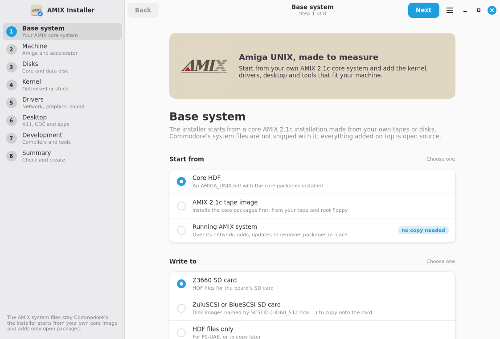
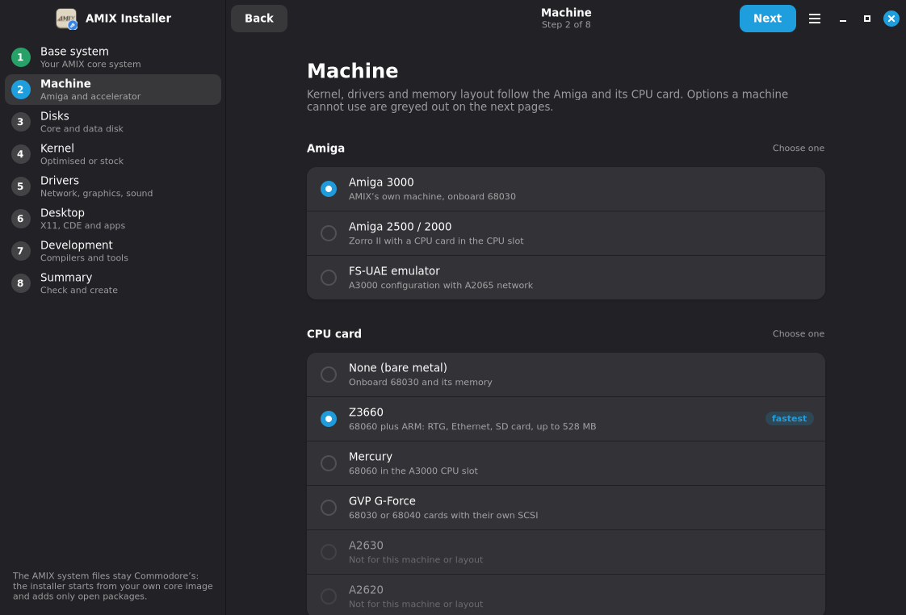
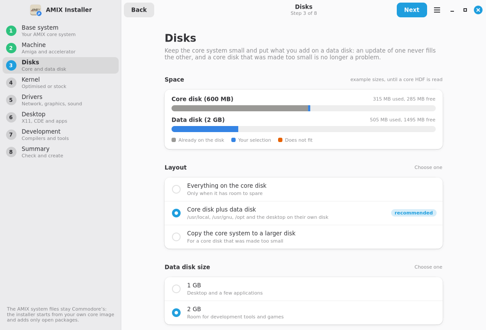
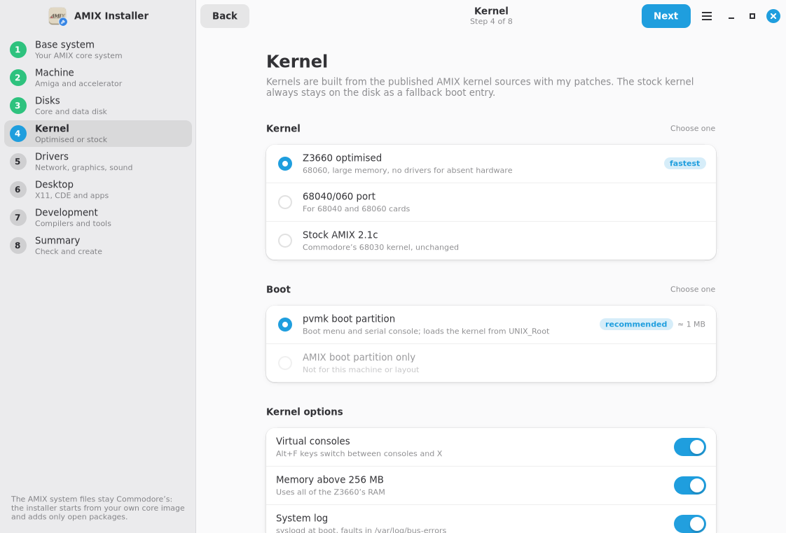
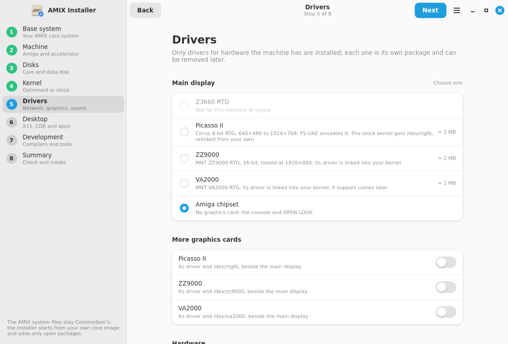
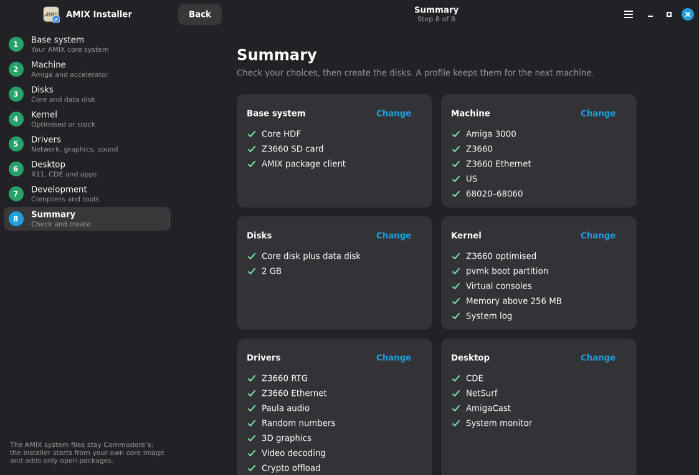

# How to: an AMIX disk with the AMIX Installer, and AMIX programs from Linux

## 1. What you need

- **Your own AMIX 2.1c core system.** One of:
  - a core HDF (an `AMIGA_UNIX.hdf` with the core packages installed),
  - the AMIX 2.1c tape image and its root floppy,
  - a running AMIX system on your network (it is changed in place).

  Commodore's files are never shipped by these packages; the installer
  copies your core and adds open packages on top.
- **For FS-UAE:** your Amiga 3000 Kickstart ROM. It is only referred to by its
  path in the FS-UAE configuration, never copied.
- **For a real Amiga:** an SD card for the Z3660, a ZuluSCSI or BlueSCSI card,
  or any way to write HDF files to the machine's disk.
- The packages from this repository (README, "Install"):

  ```sh
  sudo apt install amix-installer
  ```

  This also installs pvmk (the boot loader), the AMIX cross linker and
  assembler (`amix-gcc-27`) and the driver kits, so the installer can link the
  drivers for your cards into your kernel.

## 2. Make the disks

Start **AMIX Installer** from the applications menu (or `amix-installer`).
It has eight steps on the left; options a machine cannot use are greyed out,
with the reason.

1. **Base system.** Where you start from (core HDF, tape image, running
   AMIX) and where the result goes (Z3660 SD card, ZuluSCSI/BlueSCSI SD card,
   or HDF files only, e.g. for FS-UAE). For an SD card, choose the card
   itself (or the Z3660's `hdf` folder): the installer reads its
   configuration and shows which SCSI IDs are in use. **Files that exist
   already** says what happens to files of the same name in that folder:
   overwritten, or kept as `NAME.YYYYMMDD-HHMMSS.bak`. Choose your core HDF here; the
   installer reads it, read-only, and shows its partitions, the packages
   already installed and its kernels. For FS-UAE, choose your Kickstart ROM.

   

2. **Machine.** The Amiga (3000, 2500, 4000 or FS-UAE), the CPU card (Z3660,
   Mercury, A3640, A2630...; an A4000 runs AMIX with a 68040 or 68060 card
   and our 68040/060 kernels, its disks on the Z3660's SD card), the network card the install runs over (it gets the
   host name's address), any further network cards (driver only: set their
   addresses on AMIX), and the keyboard.

   

3. **Disks.** The core disk alone, or the core disk plus a data disk for
   `/usr/local`, `/opt` and the desktop, and its size.

   

4. **Kernel.** The Z3660 optimised kernel, the 68040/060 port kernel, or
   Commodore's stock 68030 kernel; the boot loader (pvmk, or Commodore's
   boot). The stock kernel always stays on the disk as a fallback boot entry.

   

5. **Drivers.** The main display (Z3660 RTG, Picasso II, ZZ9000, VA2000 or
   the chipset: it gets the console and X), any further graphics cards, and
   the other hardware. For every card whose driver is not in AMIX itself
   (Picasso II, ZZ9000, VA2000, HydraNet, X-Surf 100, ZZ9000 Ethernet), the
   installer links its driver into **your own** `/stand/unix` here, on Linux,
   and checks the result before anything is written.

   

6. **Desktop.** X11 with CDE or mwm, NetSurf, AmigaCast, the system monitor.
7. **Development.** Compilers and tools on AMIX itself.
8. **Summary.** Everything you chose, with **Change** links. **Create disks**
   shows what will be written and how much, and **Write** does it.
   **Save as Profile…** keeps your choices for the next machine (the menu,
   top right, opens one again); paths are not saved in profiles.

   

If files of the same name exist in the folder, the Summary lists them, with
**Overwrite** / **Keep a Backup** and **Choose Another Folder…**. A file the
installer did not write (it is not in an earlier run's `amix-installer.json`)
is overwritten only after you confirm it by name. Every new file is written
as `.part` and checked; only when all of them are does the installer replace
the old ones (or rename them to `.bak`), so a failed run leaves them as they
were.

What **Create disks** writes, next to each other in the folder you chose:

- a copy of your core disk (the original is never written),
- the pvmk boot disk (`pvmk.hdf`) with its boot menu,
- the data disk, if you chose one,
- the kernel with your cards' drivers (`unix.<drivers>`), if any,
- an FS-UAE configuration (`amix-install.fs-uae`),
- `SHA256SUMS`, a README and the record of the run (`amix-installer.json`).

Every file is written as `.part`, read back and checked, then renamed; an
SD card's HDFs are checked for fragments (the Z3660 firmware needs fewer
than 32 pieces per file).

On an SD card the AMIX disks use SCSI ID 6 (core), 5 (pvmk) and 1 (data).
If one of them is taken by another image, the installer stops before
writing anything and names the file. Otherwise, after the disks, it adds
them to the card's configuration and keeps the old file as
`<name>.amix-installer`:

- ZuluSCSI/BlueSCSI: `[SCSI6]`, `[SCSI5]`, `[SCSI1]` sections (fixed disks,
  no host quirks), the images where the card reads them;
- Z3660: the images in `hdf/`, `hdf<N>` lines in free slots, `scsi6`,
  `scsi5`, `scsi1`, and `scsiboot YES` for pvmk.

## 3. Install the packages over the network

When the disks are written, **Install over the Network** opens the next
page: **Start FS-UAE** (or start the Amiga) and type the commands it shows
at the AMIX login. AMIX then fetches everything from the
installer over the network: it makes the data disk's file system and moves
`/usr/local`, `/opt` and the desktop there, installs the package client and
the packages you chose, and installs the new kernel last (the stock one stays
as `/stand/unix.stock`). After the reboot, pvmk's menu offers the new kernel
and the stock one.

The packages come from an AMIX package repository on this computer: point
the installer at one with `--repo DIR` or `AMIX_REPO=DIR` (it is not a
Debian package yet).

## 4. Without a window

```sh
amix-installer --source AMIGA_UNIX.hdf --out ~/amix --plan          # print the plan
amix-installer --source AMIGA_UNIX.hdf --out ~/amix \
               --kickstart A3000.rom --apply                         # write it
amix-installer --source AMIGA_UNIX.hdf --out ~/amix --net           # serve the network install
```

`--profile FILE` loads saved choices; `--patch-disk ADF` applies the AmigaUNIX
2.1 patch disk when the core lacks it. `--backup` keeps files of the same
name as `.bak`; `--overwrite` replaces them, also ones the installer did not
write.

## 5. Cross compiling for AMIX

```sh
sudo apt install amix-cross-dev
```

**Applications: gcc 14** (C99, C++ with exceptions and RTTI), for every
68020-68060:

```sh
cat > hello.cc <<'EOF'
#include <cstdio>
#include <string>
int main() { std::string s("hello, AMIX"); std::printf("%s\n", s.c_str()); }
EOF
/opt/m68k-amix/bin/m68k-elf-g++ -O2 -o hello hello.cc
```

**Kernel, drivers and anything object-compatible with AMIX: gcc 2.7.2.3**,
the compiler AMIX was built with:

```sh
/opt/amix-cross/bin/m68k-cbm-sysv4-gcc -O -o hello27 hello.c
```

Both link against the AMIX sysroot in `/opt/m68k-amix-sysroot`. Copy the
program to AMIX (ftp, or the data disk) and run it there.

## 6. When something is missing

The installer never skips a step silently: the plan names what is missing
and which package has it, for example "no kernel kit for ZZ9000 yet (package
amix-zz9000-kit)" or "the AMIX cross linker m68k-cbm-sysv4-ld is not
installed". Install that package and choose **Create disks** again.

To use a kit or pvmk you built yourself instead of the packaged one:

| Variable | Points at |
|---|---|
| `AMIX_<ID>_KIT` | a driver kit for the stock kernel (`AMIX_HYDRA_KIT=...`) |
| `AMIX_KIT_TOOLS` | the kernel kit tools |
| `AMIX_PVMK_DIR` | a pvmk build (bootblock.bin, pvmk.bin, host/mkadf, host/mkhdf) |
| `AMIX_REPO` | the AMIX package repository for the network install |
